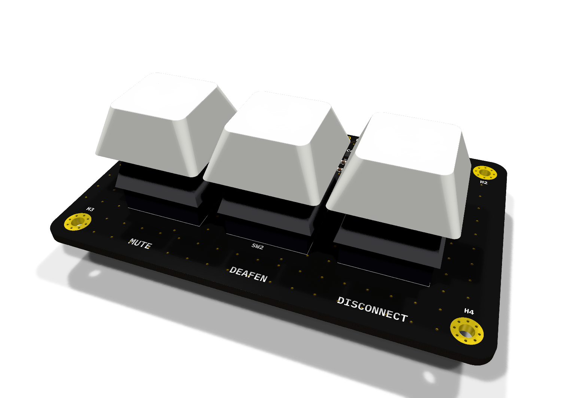

# DS2000 rev A — design notes

Rev A replaces the 2025 RP2040 draft (last seen at commit `7db9552`). It was drawn from scratch,
using the draft only as a reference, and fixes every defect found in it (DS2000-PCB#2-#10).

## Product decisions

| Decision | Choice | Why |
|---|---|---|
| MCU | Discrete **RP2350A** (QFN-60) | Same family as the RP2350-Zero test module the firmware runs on |
| Look | **Exposed PCB as the top face**, enclosure is a tray underneath | The board is the product's face: logo, art, legends in silkscreen |
| Top side | Switches, and **the RP2350A and its circuitry on show** in a strip behind the keys | The visible chip is part of the look |
| Bottom side | J1's USB-C, the debug pads (SWD, BOOT, RST), the production test pads (+5V, +3V3, +1V1) and J3's wire pads. **Every pad is on the bottom** | In the economic variant nothing on the bottom is assembled (Economic PCBA); in the standard one JLC fits J1 there too. Debug and test stay off the visible face |
| Connection | **USB-C receptacle J1 on the bottom**, in two board variants: *economic*, soldered by hand (or a USB cable soldered to J3's pads), and *standard*, fitted by JLC | Cost: having JLC fit J1 on the bottom forces two-sided assembly (Standard PCBA, about $50 more per order in fixed fees), worth it for a batch that is sold; for a few boards, the economic one |
| Layers | 4 (Sig / GND / PWR / Sig), 1.6 mm | Routes mostly on inner layers so the face stays clean, solid reference for USB and the core regulator, stiff enough to hold switches without a plate |
| Finish (proposed) | Matte black soldermask, ENIG | Gold for exposed logo copper and mounting rings |
| Keys | 3× Kailh Choc V1 (low profile), **soldered, no plate**, in a row, MBK-style keycaps | Changed from Cherry MX for a lower, flatter device. Choc V1 has two locating posts, so it sits steady without a plate |
| Size | 72 × 46 mm | 3 keys at the Choc 18 mm pitch plus corner M2 holes; the extra depth is the component strip behind the keys. Kept from the MX layout so the enclosure's numbers stay put |
| Status | **SK6805-EC20** on the top side, inside the Choc V1 LED window of the mute and deafen keys; **disconnect has no LED** | Lights the key from inside the switch; top-side, so no board cut-out and no bottom-side assembly. The WS2812B-2020 first chosen is Standard-PCBA-only at JLC; the SK6805-EC20 assembles in Economic and is thinner (0.65 mm). Needs shine-through or translucent keycaps |
| Pinout | Owned by `DS2000-Firmware/include/pins.h` | See below |

## Blocks

**USB input and power.** Two alternatives, both wired in parallel: J1, an HRO TYPE-C-31-M-12
USB-C receptacle on the bottom at the back edge, fitted by JLC in the *standard* variant and by hand
in the *economic* one; or a USB cable soldered flat to J3, four SMD pads on the bottom beside J1
(VBUS, D-, D+, GND), so the cable leaves through the enclosure's USB-C opening. R1/R2 (5.1 kΩ, top side, assembled) are the CC pull-downs that make a USB-C host supply 5 V;
they are harmless when J3 is used. VBUS is `+5V` directly, which feeds the LEDs, the level
shifter and the regulator; there is no fuse, as the host port already limits the current. C1 and C2
are 4.7 µF, so the capacitance a host sees on VBUS stays close to USB 2.0's 10 µF. USBLC6-2SC6
ESD on D+/D- between J1 and the RP2350, beside J1. XC6206P332MR LDO (SOT-23-3, 200 mA, a JLC basic part) makes `+3V3`; the
RP2350A, the flash and the shifter draw well under 100 mA, and the LEDs run from `+5V`. The RP2350
minimal design uses an NCP1117, but its ~1.1 V dropout leaves little margin from a 4.75 V VBUS.

**RP2350A.** Straight from *Hardware design with RP2350* (Minimal design, R4):

- Core supply from the on-chip switching regulator: `VREG_LX` → L1 3.3 µH → `+1V1` (DVDD ×3 and
  `VREG_FB`), C3 4.7 µF output, C4 4.7 µF on `VREG_VIN`, `VREG_AVDD` through R5 33 Ω / C5 4.7 µF.
  **L1 must be the polarity-marked Abracon AOTA-B201610S3R3-101-T, placed in the orientation and
  layout the guide shows.** Raspberry Pi explicitly says other layouts are at your own risk.
- `VREG_PGND` to GND, routed as the guide describes (not to an arbitrary via).
- **Layout: a copy of Raspberry Pi's RPI-RP2350A-MINIMAL R4-S1 board** (KiCad files, MIT), see
  *Core regulator* under Layout.
- 100 nF per power pin: C6-C11 IOVDD, C12-C14 DVDD, C15 ADC_AVDD, C16 shared by USB_OTP_VDD and
  QSPI_IOVDD (as in the reference).
- Crystal Abracon ABM8-272-T3 12 MHz (10 pF load, 50 Ω max ESR) with 15 pF load caps and 1 kΩ on
  XOUT, exactly as the reference. A cheaper basic crystal (YXC X322512MSB4SI with 33 pF) was tried in
  the cost-down, but JLC's design review flagged it against Raspberry Pi's guide; a crystal that does
  not start makes the whole batch useless, so the recommended part stays (one extended-part fee).
- USB 27 Ω series resistors R3/R4 close to the chip; D+/D- as a 90 Ω differential pair over
  unbroken GND.
- Flash W25Q32JVSSIQ (4 MB, 208 mil SOIC-8), the RP2350-Zero's size: the firmware sees the same
  flash on the test module and on rev A, with room for A/B updates (DS2000-Firmware#15). The 2 MB
  W25Q16 of the cost-down saved cents, and both are JLC extended parts.
  R7 (10 kΩ CS pull-up) is DNP as in the reference.
- BOOTSEL: no button. JP1 is a pair of bare pads (open solder jumper) that pull `QSPI_SS` low through
  R8 1 kΩ when bridged with tweezers or a wire while USB is plugged in (or RESET pressed).
  RESET: likewise pads, JP2, from `RUN` to GND; R9 10 kΩ keeps `RUN` high. Firmware updates do not
  need either: the running firmware reboots itself into USB boot (DS2000-Firmware#14, #15; DS2000#35).
- SWD on three bare pads on the bottom, TP1-TP3 (SWCLK, GND, SWDIO, the Debug Probe order); no connector.
- Production test pads on the bottom: TP4 `+5V`, TP5 `+3V3`, TP6 `+1V1` (GND on TP2), for a
  bed-of-nails or a meter. A board with blank flash enumerates as the RP2350's USB boot device, so
  test and final firmware load over USB without SWD.

**Keys and LEDs.** SW1-SW3 to GPIO0-2 and GND; the firmware uses the internal pull-ups (not
affected by the RP2350-E9 erratum, which concerns pull-downs). The LED data line leaves GPIO5 at
3.3 V and is shifted to 5 V by U5 (74AHCT1G125, TTL-level input), then R10 100 Ω, then the chain
D1 (mute) → D2 (deafen); D2's DOUT is unused. Each LED has its own 100 nF, on the top between the
keys. The SK6805-EC20 wants DIN high at 0.6 × VDD (3.0 V at 5 V, datasheet Rev A1; rev A2 said 0.7 × VDD,
3.5 V), with no margin from a 3.3 V GPIO, so the shifter is
required. It speaks the WS2812 protocol (800 kHz, GRB, reset > 80 µs) and is the 5 mA-per-colour
version: about half a WS2812B's brightness, plenty for an indicator, to confirm through a keycap on
the first boards.

## Pinout

| Function | GPIO | Net |
|---|---|---|
| Mute key | GP0 | `KEY_MUTE` |
| Deafen key | GP1 | `KEY_DEAFEN` |
| Disconnect key | GP2 | `KEY_DISCONNECT` |
| LED data (to U5) | GP5 | `LED_DIN_3V3` |

**Firmware impact** (tracked in Mechanix97/DS2000-Firmware#13): the six PWM LED pins (GP5-GP10) are gone. The firmware needs a
WS2812/SK6812 driver on GP5 (arduino-pico ships `Adafruit_NeoPixel`-compatible PIO drivers), and
`pins.h` changes accordingly. The serial protocol does not change: it already carries a colour for
each of the two status LEDs, which map one-to-one onto D1 and D2.

## Bill of materials

The MPN, manufacturer and LCSC number of every assembled part live in the schematic's fields, written
by `tools/bom/set_fields.py` (the parts table is there, with where each number was checked). The same
script copies them onto the board's footprints so the schematic parity check stays clean. Change a
part there and re-run it.

| Refs | Value | MPN | LCSC | Footprint |
|---|---|---|---|---|
| U3 | RP2350A | RP2350A | C42411118 | QFN-60 7×7 mm, thermal vias |
| U4 | Flash 4 MB | W25Q32JVSSIQ | C82344 | SOIC-8 5.3 mm |
| Y1 | 12 MHz, 10 pF | ABM8-272-T3 | C20625731 | 3225 4-pin, as the reference |
| L1 | 3.3 µH | AOTA-B201610S3R3-101-T | C42411119 | 2016, polarity dot on pad 1 = +1V1 |
| U2 | 3.3 V LDO, 200 mA | XC6206P332MR-G | C5446 | SOT-23-3, **basic** |
| U1 | USB ESD | USBLC6-2SC6 (UMW) | C2687116 | SOT-23-6 |
| U5 | Buffer, TTL in | 74AHCT1G125GW,125 | C12495 | SOT-353 |
| D1, D2 | RGB LED | SK6805-EC20 (OPSCO) | C2890036 | 2.0×2.0×0.65 mm, top, in the switch LED window; own footprint and symbol (`DS2000.pretty`, `DS2000.kicad_sym`) |
| C1, C2 | 4.7 µF 25 V X5R | CL21A475KAQNNNE | C1779 | 0805, **basic** |
| C3-C5 | 4.7 µF 10 V X5R | CL05A475MP5NRNC | C23733 | 0402 (C3/C4 wide land), **basic** |
| C6-C16, C19-C22 | 100 nF 16 V X7R | CL05B104KO5NNNC | C1525 | 0402 (C21/C22 between the keys) |
| C17, C18 | 15 pF C0G | 0402CG150J500NT | C1548 | 0402 |
| R1, R2 | 5.1 kΩ 1 %, USB-C CC pull-downs | 0402WGF5101TCE | C25905 | 0402, **basic** |
| R3, R4 | 27 Ω 1 % | RC0402FR-0727RL | C138021 | 0402, as the reference |
| R5 | 33 Ω | 0402WGF330JTCE | C25105 | 0402, **basic** |
| R6, R8 | 1 kΩ 1 % | 0402WGF1001TCE | C11702 | 0402 |
| R7 | 10 kΩ, **DNP** | 0402WGF1002TCE | C25744 | 0402 |
| R9 | 10 kΩ 1 % | 0402WGF1002TCE | C25744 | 0402 |
| R10 | 100 Ω 1 % | 0402WGF1000TCE | C25076 | 0402 |
| J1 | USB-C receptacle | HRO TYPE-C-31-M-12 | C165948 | bottom; fitted by JLC in the *standard* variant (`Config` +standard), by hand in *economic* |
| SW1-SW3 | Keys | Kailh Choc V1 (CPG1350) | — | soldered by hand |
| TP1-TP6, JP1, JP2, J3, H1-H4 | pads, jumpers, wire pads, M2 holes | — | — | bare copper |

**Ordering from JLCPCB.** CI builds the files on every change (KiBot's JLCPCB template with paste
layers, artifact `kibot-out`), once per variant: `economic/JLCPCB/` (top side only, J1 by hand) and
`standard/JLCPCB/` (JLC also fits J1). Each has the gerbers and drill zipped, the BOM and the placement
(CPL) file with JLC's rotation corrections, named after the variant (`DS2000_economic_bom_jlc.csv`,
…). Upload the zip as the PCB, then the BOM and CPL of the same variant for assembly; #31 lists what
to check in JLC's placement preview before paying. `panel/JLCPCB/` is our own 2 × 2 panel (economic, KiKit, `kibot/panel.kibot.yaml`): a frame
with fiducials and tooling holes, mouse-bite tabs on the short sides only (none on the visible front
edge, none beside J3, U1 or the back-edge MLCCs), top stencil only; its BOM and CPL number each copy (C1_1 … C1_4) while
the silkscreen keeps the board's references. Ordering single boards and letting JLC panelise them
works as well:

- 4 layers, 1.6 mm, **black** mask, white silk, **ENIG**, JLC04161H-7628 stackup
- economic: assembly on the **top side only** (Economic PCBA); standard: both sides (Standard PCBA)
- JLC prints its order number where the bottom silkscreen says `JLCJLCJLCJLC`, not on the face
- JLC's BOM page shows which lines are basic or extended parts (extended ones add a setup fee each)
- check the placement preview against #31, above all U1, J1 (standard), L1's polarity and D1/D2
  (pin 1 = GND, as in the current datasheet; the GND pad is top-right of each LED as placed), before
  confirming
- the switches are fitted by hand after assembly, and so is J1 in the economic variant if the USB-C
  is wanted instead of a cable on J3. J1 is fine pitch (0.5 mm): flux, a fine tip, and the four shell
  pins first to hold it

## Layout

**State:** placed and fully routed. ERC is clean; DRC reports no unconnected pads, no clearance or
edge errors and full schematic parity (Update PCB from Schematic reports no changes). The only DRC
items left are the text thickness notes under *Face and branding* and a local edit to Y1's footprint.

**Fixed (mechanical, agreed with the enclosure):**

| Item | Position |
|---|---|
| Outline | 72 × 46 mm, 3 mm corner radius |
| Keys | row of 3 at 18 mm pitch, centres 16 mm from the front edge, middle key on the board's centre line |
| LEDs | D1/D2 on the top, 4.7 mm south of the switch centre, inside the Choc V1 LED window (5 × 3.15 mm, opposite the switch pins), turned so DOUT faces the next LED. Their vias sit under the switch housing; C21/C22 sit between the keys, under the keycap overhang |
| Holes | 4 × M2, 4 mm in from each edge, clear of the keycaps |
| Debug | **all on the bottom**, back right: SWD pads TP1-TP3 (CK, G, IO), BOOT (JP1), RST (JP2) |
| Test pads | bottom, right of centre: TP6 `1V1`, TP5 `3V3`, TP4 `5V`, each on its net's track or via |
| USB-C (J1) | bottom, back edge centre, face overhanging the edge by 1.2 mm, as before the cost-down; the tray's USB-C cut-out stays |
| USB cable (J3) | bottom, back edge, left of J1: four SMD wire pads; the cable leaves through the tray's USB-C opening |

**Top side, around the RP2350A:** flash top-left by the QSPI pins, core regulator straight above the
VREG pins, USB series resistors beside it above D+/D-, crystal below XIN/XOUT, each decoupling
capacitor in line with its supply pin and its supply pad facing it.

**Core regulator.** Raspberry Pi says their regulator layout should be copied, not improvised: the
inductor's field upsets the output capacitor when it is the wrong way round or placed differently.
Rev A copies it from their KiCad files (RPI-RP2350A-MINIMAL R4-S1, MIT). Our U3 sits the same way
round as theirs, so every offset from VREG_LX (pin 48) carries over unchanged:

| Theirs | Ours | Part | From pin 48 (x, y), mm |
|---|---|---|---|
| C6 | C4 | 4.7 µF, VREG_VIN | (0, −1.16) |
| C7 | C3 | 4.7 µF, +1V1 output | (0, −2.10) |
| L1 | L1 | AOTA-B201610S3R3-101-T, dot (pad 1) on +1V1, left | (0, −3.75) |
| C9 | C5 | 4.7 µF, VREG_AVDD | (2.2, −1.60) |
| R3 | R5 | 33 Ω, VREG_AVDD filter | (3.65, −2.08) *(theirs: (2.2, −3.45))* |
| C12 | C16 | 100 nF, USB_OTP_VDD + QSPI_IOVDD | (−4.1, −3.95) |
| R7/R8 | R3/R4 | 27 Ω, USB | (−3.1 / −2.1, −3.95) |

- The two 4.7 µF caps use the reference's wide 0402 land (`DS2000:C_0402_1005Metric_Wide`, pads
  1.03 mm apart) so VREG_LX runs straight up between them to L1.
- VREG_PGND (47) ties to both caps' ground pads on the top layer, with two vias beside them, as in
  the reference; VREG_FB (50) is taken at the output cap; VREG_AVDD runs clear of L1.
- The tracks are hand-placed by `preroute.py` and locked; `vreg_pours.py` adds the reference's four
  small pours (PGND, VREG_LX, the +1V1 node, VREG_VIN) after autorouting.
- The reference's +3V3 pour under the package (joining VREG_VIN to pins 53/54) becomes a track in the
  same place, between the pin ring and the exposed pad, with one via to the In2 plane.
- **Two departures**, both forced by the USB-C receptacle (J1) underneath: the whole RP2350A
  cluster sits 0.5 mm lower than first placed so L1 and C16 clear J1's plastic pegs, and R5 lies
  beside C5 instead of above it, where J1's shell pin comes through. R5 only feeds the 200 µA AVDD filter, away from L1's field.

**Face and branding** (`tools/pcb-generator/branding.py`, safe to re-run on the hand-edited board):

- F.Cu carries a GND pour as well, so all four layers are ground or +3V3 wherever there is no track,
  and a discharge from a finger on the face finds ground before it finds a pin. Its thermal reliefs
  may resolve to a single spoke (`DS2000.kicad_dru`): every top GND pad already reaches In1 through its
  own via. (The pour was lost by accident in `56300c4` and restored on 2026-10-23.)
- The logos' exposed ENIG copper is pad 1 of each logo footprint (`tools/logo/copper_pad.py`), tied
  to GND on the board and joined solidly by the pour, so no touchable copper floats.
- Every reference designator is visible, placed by a script at the first spot beside its part that
  clears pads, holes, vias, other text and the board edge. At 1.0 mm the eight that find no room (C3, C12,
  C13, C16, C17, L1, R3, R6, all in the tightest spot around the RP2350A) stay hidden; they are still
  in the assembly drawings.
- Typography follows mechardo3d.xyz: Sora for "DS2000" and "mechardo labs", IBM Plex Mono for the
  key legends, references and debug labels. The fonts are embedded in the board file; `fonts/` has
  them for editing. All silkscreen text is at least 1.0 mm tall, JLC's minimum: at 0.8 mm the
  strokes measured about 0.14 mm, under JLC's 0.153 mm minimum line width. At 1.0 mm the mean stroke of
  every text is 0.154-0.19 mm (measured on the glyph outlines, 2026-10-29). KiCad still reports
  `text_thickness` on some of them: for TrueType text its check goes by size, not by the drawn stroke.
- The DS2000 logo (back left) is the product logo from mechardo3d.xyz
  (`static/images/DS2000/logo/ds2000-logo.webp`), traced by `tools/logo/gen_ds2000_logo.py` into
  `DS2000.pretty/Logo_DS2000_8.6mm`: the white lettering is silkscreen, the blue arcs become ENIG
  gold, since the board has no blue. "rev A" sits under it; the maker block (Mechardo mark with
  "mechardo / labs") sits back right.
- The Mechardo Labs mark is the mechardo3d.xyz favicon (`tools/logo/gen_logo.py` →
  `DS2000.pretty/Logo_Mechardo_5mm`): a rounded square of ENIG copper whose mask opening leaves the
  "m" covered, so it reads black on gold. The SVG's "m" is a single self-overlapping contour, so it is
  first resolved to its nonzero-fill union; taken as-is the overlaps rendered as holes.

**How it was routed** (`tools/pcb-generator/`, see `pipeline.py`):

1. `gen_pcb.py` builds the board from the schematic's netlist (footprints, nets, fields, symbol
   links), places it, and sets stackup, rules and net classes.
2. `preroute.py` hand-routes what the autorouter should not improvise, as locked tracks: the crystal
   loop (XIN 7.4 mm, XOUT 2.1 mm, crystal output 4.9 mm, no vias, the crystal turned so the two
   nets never cross) and IOVDD pin 20, which runs to its capacitor above the XIN run.
3. `fanout.py` connects every GND and +3V3 pad to its plane: RP2350A supply pins go by a short
   track straight to their decoupling capacitor, pins 53/54 share one via between the USB and QSPI
   escapes, and every other pad gets its own via, each checked for clearance before it is placed.
4. Freerouting routes the rest on F.Cu and B.Cu (In1 and In2 are planes). The top is the product's
   face, so `top_keepout.py` first puts a track keepout on F.Cu over everything but the component
   strip around the RP2350A (x 80.5-119, y 71-93.6): the keys, the logos and the sides stay free of
   tracks and every longer run (+5V to the LEDs, the debug lines, the keys) goes underneath. The
   keepout comes out again after routing. Incremental passes are kept only when KiCad's own DRC
   counts fewer unconnected items, and `cleanup_vias.py` drops any via left dangling.
5. `branding.py` finishes the face (see above) and `stitch.py` ties the F.Cu and B.Cu GND pours to
   In1 with a 3.5 mm grid of vias wherever they clear everything else (113 on rev A).

`pipeline.py` writes to `build/` and never overwrites the committed board: from now on the
`.kicad_pcb` is edited by hand in KiCad.

**3D models:** KiCad's library has no STEP for the Choc V1 switch, the HRO USB-C or the QFN-60, so
`tools/3d-models/gen_models.py` generates simplified ones from datasheet dimensions into
`3dmodels/DS2000.3dshapes/` (referenced through `${KIPRJMOD}`, so they travel with the project). The
switches also carry an MBK-style keycap model for previews and for fitting the enclosure. The Cherry MX
models stay in the generator for reference.

**Choc V1 footprint:** `DS2000.pretty/SW_Kailh_Choc_V1_1.00u`, written by `tools/footprints/gen_choc_v1.py`
from Kailh's CPG1350 datasheet; the geometry matches kiswitch's footprint of the same name (MIT). Its
courtyard follows the 13.8 mm lower housing: the 15 mm flange is 2.2 mm up, so the crystal and C18
tuck under its edge.

**Hybrid footprint (2026-10-25):** SW1-SW3 use `DS2000.pretty/SW_Hybrid_Choc_V1_MX_1.00u`
(`tools/footprints/gen_hybrid_choc_mx.py`): the Choc V1 holes plus the two pins of a 3-pin MX switch
(at (2.54, -5.08) and (-3.81, -2.54), 1.5 mm drill) and one 4 mm centre hole that takes either post.
The product keeps Choc V1 at 18 mm; MX switches are for prototypes. Every extra hole sits under the
switch housing, and both switches have their LED window south of the centre (Choc 4.7 mm, MX 5.08 mm),
so the SK6805-EC20 serves both. MX pin 1 joins Choc pin 1 with a short top track under the switch;
MX pin 2 is GND, joined by the planes. With MX switches:
- the keycaps must be 17 mm wide or less (18 mm pitch); 3D-printed ones are planned;
- a 3-pin MX is meant to sit in a plate, which this board has none of: soldered, it holds, with a little play;
- moving the +5V, LED data and BOOTSEL tracks around the new pins made BOOTSEL 53 → 63 mm.

**Long runs redrawn by hand (2026-10-29):** straight lines and 45° corners only, nothing left from the
autorouter's odd angles and jogs (`docs/img/production-review/08-hand-routes.png`).
- +5V: J3 pin 1 drops into one 45° line that carries on as the left side of the ring. Under the LEDs the
  ring is one straight bus on B.Cu; each LED's and capacitor's +5V via sits at 45° or straight below its pad.
- LED row: the DIN, DOUT and GND vias are level with their pads, and D1 → D2 data runs straight beside
  the +5V bus. The +5V run that crossed the face under SW2 is gone.
- BOOTSEL: 63 → 55 mm with five vias. It crosses +5V and GPIO1 on F.Cu in two short hops, and runs
  beside SWDIO into JP1.
- MX pin 1 → Choc pin 1 under each key: a 45° and a straight run.

**Stackup and rules:** JLCPCB JLC04161H-7628, 4 layers, 1.6 mm, black mask, white silk, ENIG.
In1 is the GND plane, In2 the +3V3 plane, F.Cu and B.Cu GND pours (solid joins on B.Cu). Minimums set for
JLC: 0.1 mm track and clearance, 0.2 mm drill, 0.3 mm copper to edge. `DS2000.kicad_dru` lets the LED
courtyards sit inside the switch courtyards. Net classes: *Plane* (GND, +3V3) reached by vias, *Power* (+5V,
+1V1, VBUS, VREG_LX) 0.4 mm, *USB* 0.2 mm tracks / 0.2 mm gap.

**Review (2026-09-28).** Every net was checked against Raspberry Pi's RP2350 minimal design and
every footprint's pin mapping against its datasheet. No wrong connection was found. (2026-10-16: the
SK6805-EC20 land pattern is taken from OPSCO's datasheet; turned 270°, every net keeps the corner it
had with the WS2812B-2020. 2026-10-29: the pins are numbered as the datasheet LCSC serves now,
SK6805-EC20-001 Rev A1, 1 GND, 2 DIN, 3 VDD, 4 DOUT, with the silkscreen chamfer on GND. Rev A2
numbered the same corners 1 VDD, 2 DOUT, 3 GND, 4 DIN, which put our pin-1 mark on the opposite corner
from JLC's pin 1 and invited a 180° placement that reverse-powers the LED.)
The review did find routing the autorouter had done poorly, since fixed: XIN was 14 mm with two
vias and the QSPI clock 35.5 mm with four (now 7.4 mm with none, and 11 mm with two). The USB data
lines ran ~25 mm from J3's old holes to U1; since 2026-10-23 J3 sits beside J1 and its branch is a
coupled pair of ~12 mm (0.25 mm tracks, 0.15 mm gap, about 90 Ω on this stackup).

**Review before ordering:**

- **LED window height:** the SK6805-EC20 is 0.65 mm tall and sits inside the Choc V1 LED window.
  Measure the window's height above the board on a real switch (it needs at least 0.7 mm) before
  ordering.
- Core regulator: copied from the reference (see above). At assembly, check L1's dot sits on the
  left, towards +1V1 (the silkscreen dot marks it).
- USB: confirm the 90 Ω pair geometry (0.25 / 0.15 mm on F.Cu over In1) with JLC's impedance
  calculator for this stackup. The J1 → U1 → R3/R4 run is a few millimetres and cannot be a clean
  pair (the USB-C's interleaved pins, the ESD part's pass-through), which is irrelevant at 12 Mbit/s.
- Under the keycaps (outside each switch's 13.8 mm lower housing) parts are hidden but must stay under
  ~2 mm high: the switch flange is 2.2 mm up and a pressed Choc keycap comes down close to it.
- Confirm the LED side against your switches: the footprint assumes the LED window is on the side
  opposite the two switch pins, as in Kailh's CPG1350 drawing.

## Open items

- [ ] Review the routed board (see Layout, *Review before ordering*)
- [ ] Mute and deafen keycaps must be shine-through or translucent for their LEDs to be visible
- [ ] First boards: fit a 3-pin MX (Kailh Blue) and check it seats flat over the LED and the light shows
- [ ] ESD check of the exposed face on the first boards (IEC 61000-4-2 style: discharges to the logos,
  the RP2350A strip and the screw heads), now that the face has a GND pour and grounded logos

## Regenerating the schematic

`tools/schematic-generator/gen_sch.py` produced the first version of `DS2000.kicad_sch`: one titled
box per stage, wired inside each stage, net labels only between stages. `check_netlist.py` compares
KiCad's netlist export with the connectivity declared in the generator; both it and ERC (0
violations) passed. From here on,
**the `.kicad_sch` is the source of truth**: edit it in KiCad. The generator is kept only as a
record of how the first version was derived.
