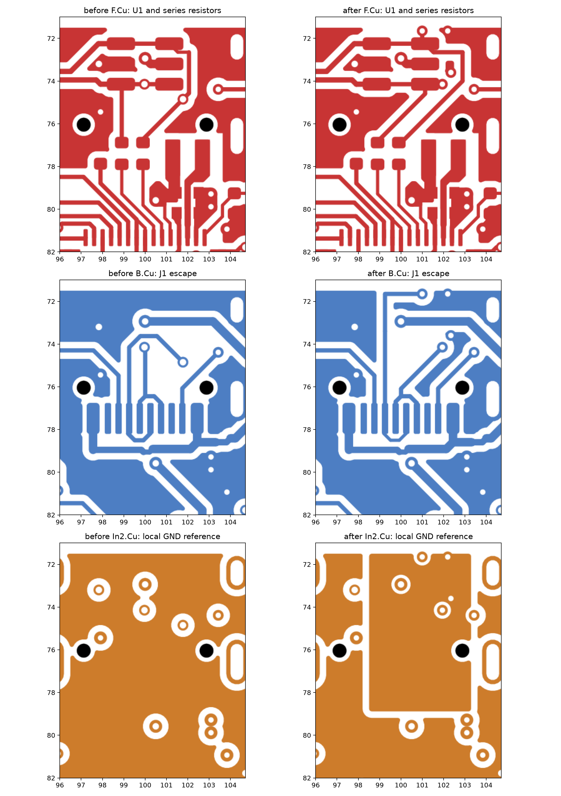
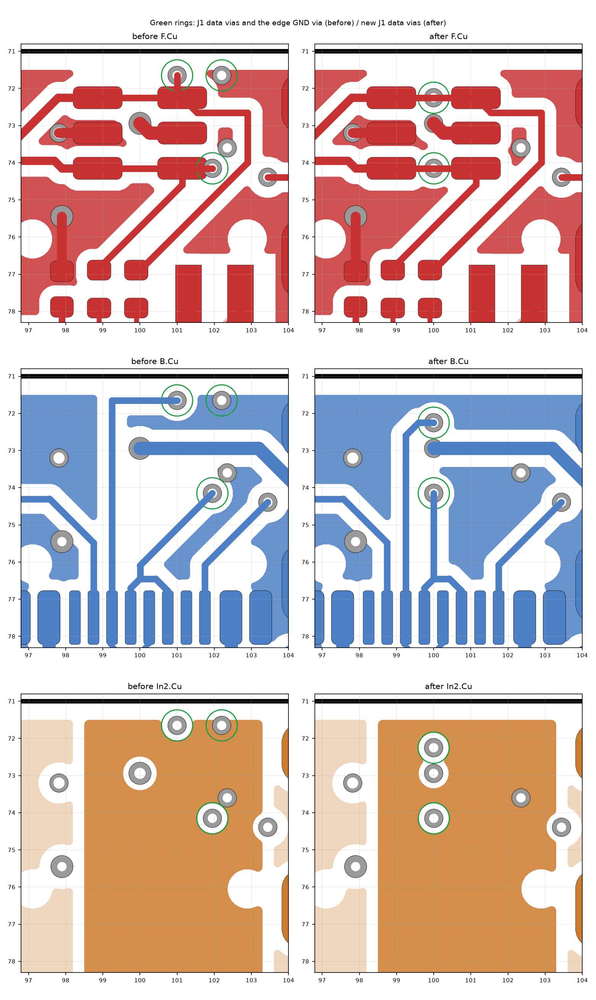

# USB and ESD layout correction

Reviewed against main `963a34227c064155c3e0f300d7a433a718583071` on 2026-10-30.

J1 D− previously joined the route to R4 at a via, leaving approximately 3.4 mm of
track as a branch to U1. The connector-side netclass pattern also missed the leading
slash in the actual net names. This correction moves the J1 junctions onto U1's
signal pads and gives bottom-layer USB escapes an adjacent GND reference.

The rows show F.Cu, B.Cu and In2.Cu in board coordinates, viewed from the top.
On the final In2 view, the new rectangular region beneath J1 is GND; the surrounding
plane remains +3V3. The matching reference zone beneath J3 is outside this crop.

## Changes

- J1 D+ and D− vias sit between U1's pad columns, on the copper bridges that join
  pads 3/4 and 1/6; the routes to R3/R4 leave pads 4 and 6. U1 remains a shunt
  protector, not a series component. (Placement revised after review, see below.)
- Two priority-10 GND zones on In2 cover the J1 and J3 bottom escapes. Two new
  through GND vias connect these references to In1 and the outer ground pours.
  Each new reference zone fills as one connected island containing a stitching via.
- `/USB_CONN_P` / `/USB_CONN_N` and `/USB_P` / `/USB_N` use KiCad's recognized
  differential-pair suffixes. The USB netclass pattern is `/USB_*`.
- DRC enforces USB track widths of 0.15–0.25 mm and prohibits inner-layer USB tracks.
  The MCU-side pair is limited to 5 mm and 0.5 mm skew. Its unchanged track lengths
  are 4.061 mm and 3.818 mm, with 0.244 mm difference.
- Component positions, footprints, BOM, non-USB tracks and firmware pin mapping are
  unchanged. The regulator isolation introduced by PR #33 is preserved.

## Validation

- KiCad 10.0.4 ERC: zero violations.
- DRC with schematic parity: zero errors, zero unconnected pads, zero parity issues;
  the same 17 pre-existing library/silkscreen warnings remain.
- Every pad's normalized net, position, size and orientation matches the baseline;
  all non-USB tracks/vias match, apart from the three added GND vias.
- KiCad resolves both intended differential pairs and applies the USB class to all four nets.
- Negative checks on a disposable copy trigger each new rule: width, inner-layer
  routing, MCU length and MCU skew.
- Copper geometry checks retain zero In1 copper beneath LX, the isolated top PGND
  island and both regulator ground returns. No F.Cu USB track crosses the In1
  regulator keepout.

## Via placement follow-up

The first version of this change left three vias that DRC does not flag:

- J1's D+ via at (101.95, 74.15) overlapped U1 pad 4 by about 0.1 mm. U1 is reflowed,
  so the via would wick solder from the joint.
- J1's D− via at (101.0, 71.65) and a GND stitching via at (102.2, 71.65) had their rings
  0.35 mm from the back edge. The outer pours stop 0.5 mm in and the board keeps vias
  at least 0.9 mm from the edge; the 0.3 mm edge rule does not catch this.

Both data vias now sit in the 0.96 mm gap between U1's pad columns, on the bridge
track that already joins the two pads of each I/O pair: D+ at (100.0, 74.15), D− at
(100.0, 72.25), each ring 0.22 mm clear of the pads. J1's D− escape turns into its via
below the edge keepout instead of running along the edge. The VBUS via beside D− went
from 0.6/0.3 mm to the board's standard 0.5/0.25 mm to keep 0.19 mm between the rings.
The edge GND via has no legal spot inside the In2 reference island, so it is removed;
the island stays connected through its other via at (102.35, 73.6).

## Limits and prototype checks

J1 and J3 remain electrically parallel alternatives. The unused branch remains a
stub; this change does not provide population-selectable isolation. The connector
escapes and U1 approaches are not continuously coupled differential pairs, and the
netclass's preferred gap is not a board-wide gap constraint. Neither the 90 Ω
target nor ESD immunity is certified by these geometric checks.

Before production, validate the fabricated stackup and USB signal quality. On the
prototype, verify ROM USB boot, firmware enumeration and sustained transfers for
both J1 plug orientations and the J3 cable configuration. ESD immunity requires
physical testing; routing improvements alone do not establish a test rating.

References: [TI ESD Protection Layout Guide](https://www.ti.com/lit/an/slva680a/slva680a.pdf)
for avoiding remote TVS branches and providing short discharge paths, and
[KiCad 10 PCB Editor documentation](https://docs.kicad.org/10.0/en/pcbnew/pcbnew.html)
for pair naming, netclass matching and custom-rule semantics.
