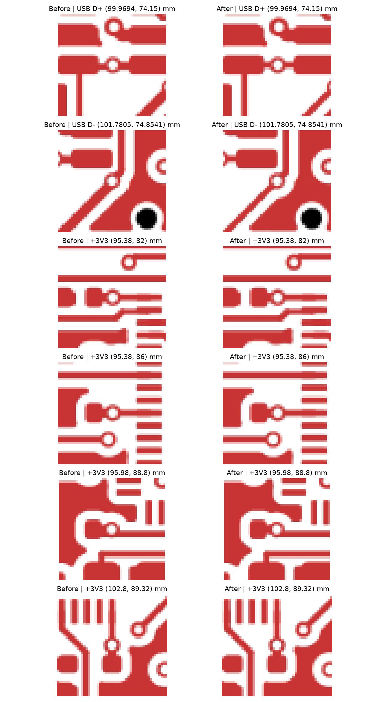

# Full-board via review

Reviewed all 194 PCB vias on base `fb59f1f` (includes #34), using individual F.Cu/B.Cu closeups and whole-board DRC with refilled zones and schematic parity. The inventory records every via UUID and location, including unchanged vias: [CSV](via-inventory.csv).

92 vias have same-net track contacts; 102 have no track contacts and belong to GND plane stitching. These counts describe the reviewed base. Visual review covers both outer copper layers; electrical clearance and connectivity checks cover the complete board. This is layout verification, not hardware testing or a USB signal-integrity simulation.

The inventory is a snapshot of that base. The USB correction that followed removed the two
USB_CONN vias listed below, renamed the USB nets to `_P`/`_N`, and placed J1's data vias between
U1's pad columns plus two In2 reference GND vias ([USB layout review](usb-layout-review.md)).

## Changes

| Net | Via position (mm) | Cleanup |
|---|---|---|
| USB_CONN_DP | 99.9694, 74.15 | Remove redundant overlapping approach segments |
| USB_CONN_DM | 101.7805, 74.8541 | Replace overlapping approach with one centered diagonal |
| +3V3 | 95.38, 82 | Terminate MCU trace at via; retain wider capacitor connection |
| +3V3 | 95.38, 86 | Terminate MCU trace at via; retain wider capacitor connection |
| +3V3 | 95.98, 88.8 | Replace grazing entry with centered approach |
| +3V3 | 102.8, 89.32 | Terminate MCU trace at via; retain capacitor connection |

Some changes remove duplicate track objects without materially changing the visible copper outline. Intentional inline taps, clear plane connections, and local regulator pours are retained.

## Validation

- KiCad 10 ERC: 0 violations.
- Refilled whole-board DRC: 0 errors, 0 unconnected items, 0 schematic parity violations; same 17 existing warnings (15 silkscreen and 2 library footprint mismatches).
- All non-zone/non-segment PCB forms are byte-for-byte unchanged: all 194 via positions, sizes, drills and nets, footprints, pads, board edges and stackup are retained.
- Regulator checks from #33 still pass: no In1 copper below the complete LX projection; local PGND copper island remains separated from global F.Cu ground, with both return vias connected to In1 ground.
- No In1 GND area was removed below the top USB copper relative to the original audit baseline.
- Schematic netlist exported successfully; schematic and pad/net assignments remain unchanged.
